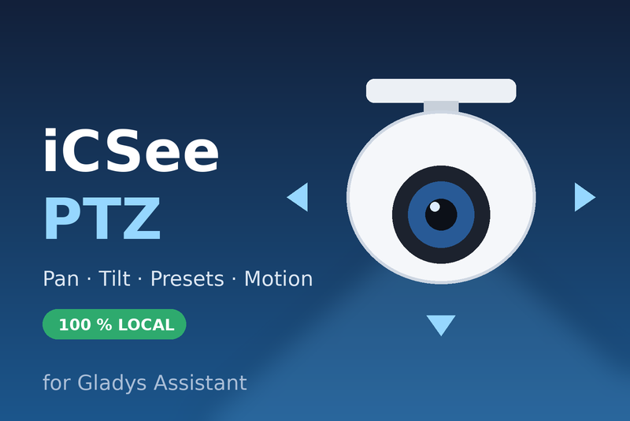

# iCSee PTZ — Gladys Assistant integration

External integration for [Gladys Assistant](https://gladysassistant.com) that
controls the motorized **iCSee / XMEye** cameras (Xiongmai firmwares, sold as
Jennov, Hiseeu, Floureon, Sricam...) **locally**, with their native DVRIP
protocol: no cloud account, no internet connection.



| Feature             | How                                                                                 |
| ------------------- | ----------------------------------------------------------------------------------- |
| Camera image        | Pushed every N seconds + fresh capture on demand (firmware snapshot, RTSP fallback) |
| Pan / tilt / zoom   | Gladys camera `move` feature (`CAMERA_MOVE` values), watchdog-bounded (5 s max)     |
| Presets             | Gladys camera `preset` feature, scene actions to go to / save a preset              |
| Motion / person     | `motion-sensor` feature + "iCSee camera: detection" scene trigger                   |
| Online / offline    | Transport badge + "iCSee camera: online / offline" scene trigger                    |
| Scene actions       | Move, go to preset, save preset, refresh image, restart                             |
| Dashboard widgets   | "iCSee PTZ control" (image, status, arrows), "iCSee presets"                        |
| Configuration tools | Test the cameras, search the network (DVRIP broadcast), restart a camera            |
| Languages           | English, French, German, Spanish                                                    |
| Transport           | `local` only                                                                        |

User documentation: [English](docs/en.md) · [Français](docs/fr.md) ·
[Deutsch](docs/de.md) · [Español](docs/es.md).

Requires **Gladys 5.1.0** or later (scene triggers, scene actions and
widgets).

## Install

In Gladys: **Integrations → Store → iCSee PTZ → Install**, then fill in the
camera addresses and the device password set in the iCSee app. To test a build
before it reaches the store, paste the manifest of the
[Build workflow summary](../../actions/workflows/build.yml) in
**Integrations → Install an integration → Developer mode**.

## How it works

```
Gladys core ⇄ (WebSocket + host API, SDK) ⇄ this container ⇄ (DVRIP TCP 34567, RTSP 554) ⇄ cameras
```

- `src/dvrip/` implements the protocol with Node built-ins: 20-byte header,
  JSON payloads, the "Sofia" MD5 login hash, the alarm subscription (motion,
  person) and the OPPTZControl / OPSNAP / OPMachine commands.
- `src/camera.js` keeps one session per camera, reconnects with a backoff,
  bounds every movement with a watchdog (the Gladys PTZ spec safety rule) and
  turns the alarms into detections.
- A device is identified by the camera **serial number**: it survives an IP
  change, and `/data/cameras.json` remembers it so an offline camera keeps
  its place in Gladys.
- `ffmpeg` (bundled in the image) re-encodes the snapshots to the 150 KB
  Gladys accepts and grabs an RTSP frame on the firmwares without a snapshot
  command.

## Development

```bash
npm install
npm test              # node --test, against an in-memory DVRIP camera and the SDK fake Gladys
npm run lint
npm run format:check
```

Run it against a Gladys instance:

```bash
GLADYS_HOST_API_URL="http://localhost:1443" \
GLADYS_INTEGRATION_TOKEN="<token>" \
GLADYS_INTEGRATION_SELECTOR="icsee-ptz" \
ICSEE_DATA_DIR=./data \
LOG_LEVEL=debug \
npm start
```

See [CLAUDE.md](CLAUDE.md) for the architecture and the project rules.

## Release

Describe the changes under `## [Unreleased]` in [CHANGELOG.md](CHANGELOG.md),
then run **Actions → Release → Run workflow** (`patch`, `minor` or `major`):
the workflow bumps the version everywhere, tags, builds the
`linux/amd64` + `linux/arm64` image to `ghcr.io/gboulvin/gladys-icseeptz` and
publishes the GitHub Release. The image package must be **public** on GHCR for
Gladys to pull it.

Validate against the store rules before a release:

```bash
npx github:GladysAssistant/integration-store .
```

## Security

See [SECURITY.md](SECURITY.md) to report a vulnerability.

## License

Apache-2.0
